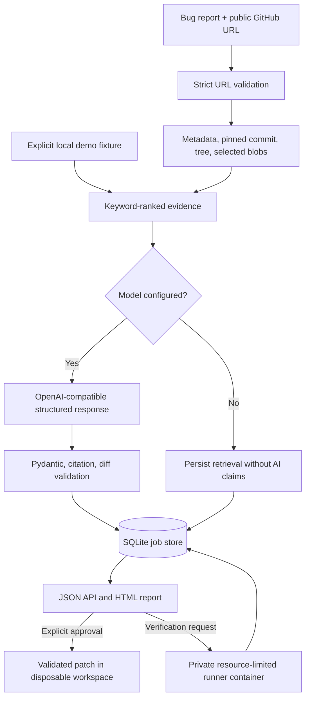

# Architecture

RepoPilot AI is a synchronous, bounded investigation workflow using FastAPI and SQLite, with optional structured model analysis and a separate private runner service for Python pytest suites.

## Repository ingestion

`repopilot.GitHubIngestor` accepts HTTPS URLs on `github.com` only. It calls a fixed GitHub API host for public repo metadata, the default-branch commit SHA, its tree, and selected Git blob contents. File count, per-file size, and total index bytes are bounded. When tests are present, a small portion of the file budget is reserved for Python test files so verification can be attempted. Truncated or over-budget trees are labeled `partial`; failed GitHub requests never fall back to fabricated repository data.

`demo://session-expiry` is an explicit fixture. Reports identify the mode and `local-demo` revision.

## Retrieval and model

Keyword retrieval ranks bounded source sections and carries original relative paths and one-based line ranges into reports. Semantic embeddings and cross-file dependency extraction are not implemented. When configured, `LLMProvider` sends issue text plus retrieved snippets to an OpenAI-compatible Chat Completions endpoint. Remote endpoints must use HTTPS. Responses are validated with Pydantic; citations must match retrieved ranges and patches must be valid unified diffs limited to retrieved paths.

The authenticated `POST /api/diagnostics/provider` endpoint performs an explicit `/models` connectivity/credential check. That is a diagnostic, not proof that structured analysis succeeds for a particular model.

## Persistence and patch review

SQLite preserves the existing `jobs` table and adds detail/event columns on startup when needed. Patch approval validates again, writes indexed sources into a temporary directory, checks/applies the diff with `git apply`, captures the approved source snapshot, and discards the workspace. The original repository is never modified. The approved snapshot is what the verification runner receives.

## Verification runner

When `REPOPILOT_RUNNER_URL` is configured, the API sends a bounded text-file snapshot to the private runner. The runner only accepts Python pytest files, validates paths and size limits, writes them into a temporary directory, and executes pytest in a separate container. It has no published host port, uses an internal Docker network, runs unprivileged, has no Linux capabilities, a read-only root filesystem, no-new-privileges, bounded temporary storage, CPU/memory/PID limits, a process-group timeout, and bounded output. It does not install repository dependencies or allow arbitrary shell/npm commands. Missing tests are `INCONCLUSIVE`; failed imports or tests are not represented as passing.

Containers still share the host kernel. For hostile public workloads, use a per-job microVM or equivalent stronger isolation, deny all egress, narrow the private runner protocol further, and obtain an independent security review.
